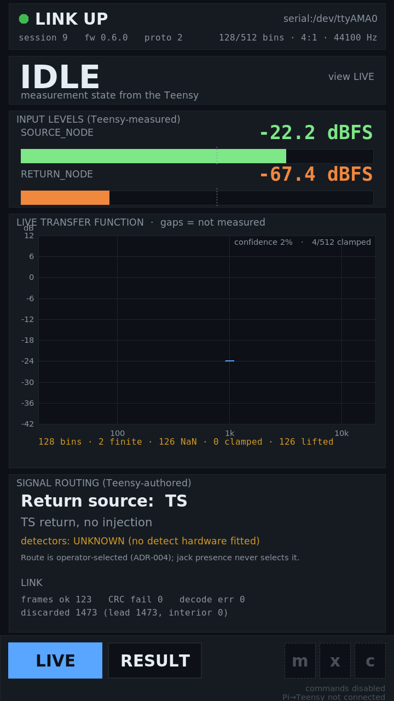
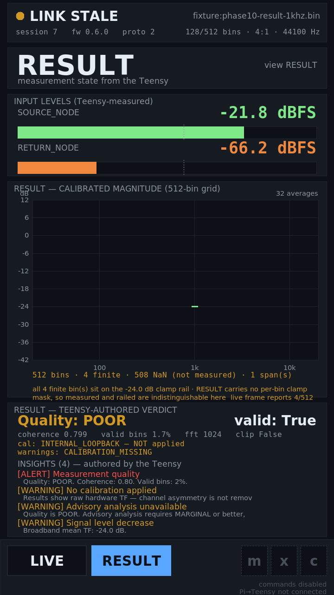
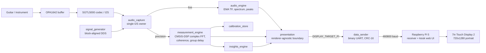
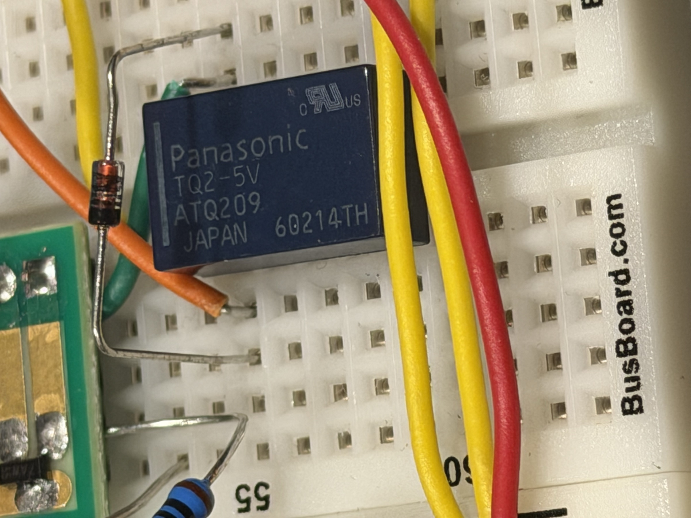

# Guitar Rig Analyzer

A bench instrument that measures what a guitar rig — a pedalboard, an amp front
end, a cable, an effects loop — actually does to a signal. It computes the
per-frequency transfer function `H(f) = RETURN / SOURCE`, along with coherence,
group delay, peak levels and clipping flags, and displays them on a touchscreen.

A **Teensy 4.1** acquires the audio and computes the measurement. A **Raspberry
Pi 5** displays it. The governing rule is *"the Teensy determines truth, the Pi
presents truth"* — the display can never originate a measurement value or decide
whether one is valid.

> **I built the hardware. AI wrote most of the software.** I designed the
> architecture, selected and bought the components, assembled the instrument and
> took every measurement in this repository; Claude generated most of the
> firmware and the Pi code. All 159 commits carry an AI co-authorship trailer.
> The full accounting is in **[docs/ai-assistance.md](docs/ai-assistance.md)**.
> — Conley Vidal

| The panel, rendering live telemetry | A completed measurement |
|---|---|
|  |  |
| A ~1 kHz tone into `SOURCE`, read live off the physical UART. One mark sits at the stimulus; **126 of 128 bins are left blank because the instrument had no measurement for them.** | A real `RESULT` captured off the wire, rendering the Teensy's own quality grade, coherence, calibration status and insights verbatim. |

---

## The problem I wanted to solve

I started this project because I was frustrated with how hard it was to
understand what was happening to my guitar tone. I could spend hours changing
amps, pedals and settings on my Headrush and still not actually *see* how any
one of those changes affected the signal — I only ever heard the result.

I wanted to build something that could measure those differences instead of
relying entirely on my ears: put a known signal in, capture what comes back,
and show the change frequency by frequency.

---

## What is working

Verified on physical hardware:

- **The measurement link.** A complete 8,908-byte `RESULT` crossed the physical
  UART and passed CRC with all four 512-bin arrays intact — including their
  per-array `NaN` conventions, so an unmeasured bin stays unmeasured instead of
  becoming a plausible zero.
- **Sustained throughput of 36,481 B/s** with zero CRC failures and zero
  interior byte loss. Separately, **6.5 MB** of real instrument bytes replayed
  with every discarded byte accounted for by absolute offset.
- **The Pi renders live telemetry** off the real UART and boots straight into it
  with no keyboard and no terminal — a four-tab kiosk at 60 fps on the Pi's GPU,
  with touch navigation confirmed.
- **Receive-only by construction.** The Pi opens the port `O_RDONLY`; it cannot
  transmit even by accident, and Teensy→Pi is the only direction wired.
- **Relay signal routing.** Phases 6–8 built and contact-proven: both TQ2-5V
  relays transfer and return, and the XLR return path passes signal.
- **The analog front end is stable.** After the common-mode correction (below),
  the buffer's input droop went from 327 mV to **6 mV**, and moved only 3–4 mV
  over three days of handling and power cycling.

## What is *not* proven — stated deliberately

This section exists because every status in this project is either observed or
explicitly marked unproven, and the two are never collapsed.

- **The instrument has not yet measured a real guitar rig.** Everything above is
  the instrument *working* — a link, a renderer, a panel. The first measurement
  of an actual rig is written up and not yet run (`ai/todo.md` TODO-91). This is
  the most important open item in the project.
- **Measurement accuracy is unestablished.** The four known-signal validation
  tests — flat loopback, channel-swap symmetry, known gain offset, known RC
  filter — have not been passed. The instrument produces a curve; nothing here
  demonstrates it is the *correct* curve.
- **T1 — "transmission must not perturb acquisition" — is not adjudicated.** The
  first hardware run of the timing harness exposed a defect *in the harness*: it
  compared an audio-block counter against an analysis-block stride and reported
  44,490 skipped blocks that never happened. Acquisition was healthy; the
  instrument measuring it was not.
  [The defect record](ai/evidence/2026-09-29-t1-harness-block-stride-defect.md).
- **`RESULT` carries no per-bin clamp mask**, so a value sitting on the −24 dB
  rail cannot be distinguished from a real measurement. The UI says so on screen
  rather than guessing.
- **The analog bias is a bring-up configuration, not a final design.** It is
  documented as temporary with its replacement already scoped.
- **Jack presence detection was never built** — the installed jack has no
  switched contact, and the feature was re-scoped to informational
  ([ADR-003](docs/adr/ADR-003-jack-presence-is-a-ux-feature.md)).
- **Not implemented:** `MODE_PRECISION` and `MODE_LF` (the engine rejects them),
  the internal log-sweep generator (stubbed), and Pi→Teensy control (physically
  unwired, so a measurement can only be armed from the Teensy's USB console).

---

## How it works



**The Teensy is the sole authority for measurement truth.** Acquisition, DSP,
calibration, routing, insight generation and quality grading all happen on the
Teensy and leave it as *verdicts* through a renderer-agnostic presentation
boundary. The Pi formats, plots, animates and navigates; it never computes
anything that decides whether a measurement is valid.

That division is not stylistic. An absent display once stretched the audio block
period from 46 ms to 2,194 ms and destroyed acquisition — so a renderer failure
is now non-fatal by contract. Both decisions are recorded in
**[ADR-001](docs/adr/ADR-001-display-architecture.md)** and
**[ADR-005](docs/adr/ADR-005-pi-rendering-stack-and-presentation-semantics.md)**.

Measurement internals: complex-FFT accumulation via CMSIS-DSP `arm_cfft_f32()`,
an H1 estimator, cross-spectrum, coherence γ², and atan2-unwrapped group delay,
driven by a state machine (`IDLE → ARMED → CAPTURE → PROCESSING → RESULT`, with
a sticky `ABORTED` that must be acknowledged). The FFT runs 50% overlap, so
results arrive every 512-sample **hop** — 46.4 ms, measured at 46.3 ms on
hardware.

---

## Hardware

| | |
|---|---|
| MCU | Teensy 4.1 — NXP iMXRT1062, Cortex-M7 @ 600 MHz |
| Audio | Teensy Audio Shield Rev D (SGTL5000 codec), I²S |
| Analog front end | OPA1642 JFET op-amp, hand-soldered to a Proto-Advantage PA0001 SOIC-8 adapter, biased at 0.874 V by a 47 kΩ / 10 kΩ divider |
| Signal routing | 2× Panasonic TQ2-5V relays (ATQ209), MMBT3904 drivers, 1N4148 flyback diodes |
| Connectors | 3× Switchcraft #11 1/4" jacks, 1× Neutrik XLR |
| Display | Raspberry Pi 5 + 7" Touch Display 2 (720×1280 portrait) + Freenove HAT |
| Storage | microSD via the Teensy's SDIO — binary `.cal` files, JSON/CSV export |
| Link | Teensy `Serial1` → Pi `/dev/ttyAMA0`, 460800 baud, CRC-16/CCITT |

Built on a breadboard, phase by phase, against a written bring-up procedure.
The as-built record — netlist, schematics, and every deviation from the
procedure — is in **[docs/asbuilt/](docs/asbuilt/)**, generated from a single
source by [tools/gen_schematic.py](tools/gen_schematic.py).



*Phase 6, after the coil polarity fix. The record for this photograph is careful
about what it does and does not show —
[see it here](ai/evidence/2026-09-16-phase6-flyback-diode-seated.md).*

---

## Engineering record — start here

The reasoning trail is large (about 9,000 lines of journal). These five entries
are the way in, and [`ai/README.md`](ai/README.md) explains how claims in it are
graded.

1. **[The OPA1642 common-mode defect](ai/journal.md)** *(journal `2026-09-05 (1)`)* —
   the buffer was biased outside the part's specified input range. Two plausible
   hardware hypotheses were wrong; the real defect was in the written procedure.
   The suspect chip was **exonerated by measurement**, not replaced on suspicion.
2. **[Phase 6 halted on column 45](ai/journal.md)** *(journal `2026-09-15 (1)`)* —
   the procedure called a breadboard column free. I remembered building
   something there and asked before fitting the jumper; the next power-up would
   have driven a 3.3 V output onto the analog reference rail.
3. **[The timing harness that lied](ai/evidence/2026-09-29-t1-harness-block-stride-defect.md)** —
   44,490 skipped audio blocks that never happened.
4. **[The buffer DC checkpoint](ai/evidence/2026-10-08-ampout-buffer-dc-checkpoint.md)** —
   a record that declines to promote its own claims: *"no numbers were recorded,
   so that is `RPT` and is not evidence of a value."*
5. **[What the design references are allowed to mean](docs/ui/references/README.md)** —
   nineteen visual references catalogued, **six marked as fabrications** because
   the numbers on them correspond to no sensor this instrument has.

Also: **[docs/adr/](docs/adr/)** (five architecture decisions, with their
supersessions), **[docs/breadboard_bringup_v3.md](docs/breadboard_bringup_v3.md)**
(the bring-up procedure, carrying a correction pass for eleven defects found
while building the board), and **[ai/evidence/](ai/evidence/)** (raw captures,
serial logs, and the archived firmware image that was actually flashed).

---

## Repository structure

```
Firmware (Teensy 4.1) — repo root, ~15,500 lines of C++
  guitar_rig_analyzer.ino     setup(), loop(), the single-key serial shell
  config.h                    pins, FFT/display constants, FIRMWARE_VERSION
  audio_capture.{h,cpp}       single I2S owner, dual-consumer model
  audio_engine.{h,cpp}        live display: EMA transfer function, spectrum, peaks
  measurement_engine.{h,cpp}  precision state machine + complex FFT + calibration
  measurement_core.h          shared result/calibration structs
  signal_generator.{h,cpp}    block-aligned sine / white / pink noise
  signal_router.{h,cpp}       relay routing + jack detect
  calibration_store.{h,cpp}   binary .cal with CRC-32 and atomic save
  insights_engine.{h,cpp}     separates MEASUREMENT facts from ADVISORY inference
  export_engine.{h,cpp}       JSON fingerprint / CSV baseline to SD
  presentation.{h,cpp}        THE boundary — compile-time dispatch, one-way
  data_sender.{h,cpp}         binary UART to the Pi (production backend)
  display_engine.{h,cpp}      RA8875 panel (debug backend, demoted by ADR-001)
  validation.{h,cpp}          four-test known-signal harness
  timing_probe.{h,cpp}        block-timing instrumentation

Raspberry Pi 5 — pi/, ~11,500 lines of Python + ~1,900 of JS/CSS
  analyzer_link/              wire protocol: CRC, framing, packets, state model
  analyzer_link/presentation_semantics.py
                              one classification layer, shared by all renderers
  web/                        kiosk server + ES-module/three.js client (production)
  web/static/view_*.js        the four tabs: LIVE, TONE, LAB, INFO
  analyzer_ui/                Tkinter renderer — demoted by ADR-005, kept in role
  tests/                      518 tests, Python standard library only
  tools/                      capture, replay, byte audit, T1 diff

Documentation and record
  ai/README.md                how to read the engineering record  ← start here
  ai/journal.md               dated reasoning trail, newest first
  ai/todo.md                  open work, each item with its proof criterion
  ai/evidence/                raw captures, logs, photographs, flashed firmware
  docs/ai-assistance.md       what I did, what AI did
  docs/adr/                   architecture decisions
  docs/asbuilt/               netlist + generated schematics
  docs/breadboard_bringup_v3.md   the build procedure
```

> **Build inputs are the repo root only** — `*.ino`, `*.cpp`, `*.h` at the top
> level. Nothing in `ai/`, `docs/`, `pi/` or `tools/` is compiled into the
> firmware.

---

## Building and running

**Firmware.** Arduino IDE with Teensyduino, or `arduino-cli`:

```sh
arduino-cli compile --fqbn teensy:avr:teensy41 .
```

Select the display backend with `DISPLAY_TARGET` in [config.h](config.h) —
`DISPLAY_TARGET_PI` is production. The Adafruit RA8875 libraries are needed
*only* for the debug backend. Current version: **0.6.0**. The wire format
carries its own `PI_PROTOCOL_VERSION` (**2**), deliberately separate so a
firmware bump cannot invalidate a working receiver.

**Pi side.**

```sh
sh pi/run_web.sh      # kiosk web renderer (production)
sh pi/run_tests.sh    # the test suite
```

Python 3 standard library only — no pytest, no numpy, no network calls.

---

## Testing — and what the tests do not prove

`sh pi/run_tests.sh` runs **518 tests** and they pass. Two of them are worth
naming: one parses the real Teensy headers and fails if the wire format drifts,
and one fails if the renderer ever contains `fetch(`, `WebSocket`,
`AudioContext` or `getUserMedia` — enforcing the rule that the display cannot
acquire or compute a measurement of its own.

**What those 518 tests establish is that the receiver matches the firmware's
declared contract. They establish nothing about measurement accuracy.** They run
against synthetic vectors, which means they test a decoder against its own
specification.

The project has already proven why that distinction matters: a **UTF-8 em dash**
in the firmware's status strings was being mangled by an ASCII decoder, and it
was invisible to every synthetic test because the test vectors used a hyphen.
Only real bytes from real hardware found it.

Hardware verification is the four-test validation harness in
[validation.cpp](validation.cpp), and it has not been passed — see *"What is not
proven"* above.

---

## My contribution, and AI's

I identified the problem, chose the two-processor architecture, selected and
bought the hardware, soldered and assembled the instrument, took every
measurement in this repository, and insisted the documentation distinguish what
had been *written* from what had been *proven* on the board.

Claude generated most of the firmware and most of the Pi code. I am not its
independent author.

Full accounting, with three cases graded individually:
**[docs/ai-assistance.md](docs/ai-assistance.md)**.

---

## Notes

- This is an in-tree firmware project, not a library — no installer, no CI, no
  release artefact.
- No network surface. The Pi link is a local point-to-point display connection,
  currently outbound only.
- No secret material in the repository. No `LICENSE` file is committed yet.

**Conley Vidal** — sole builder and maintainer.
