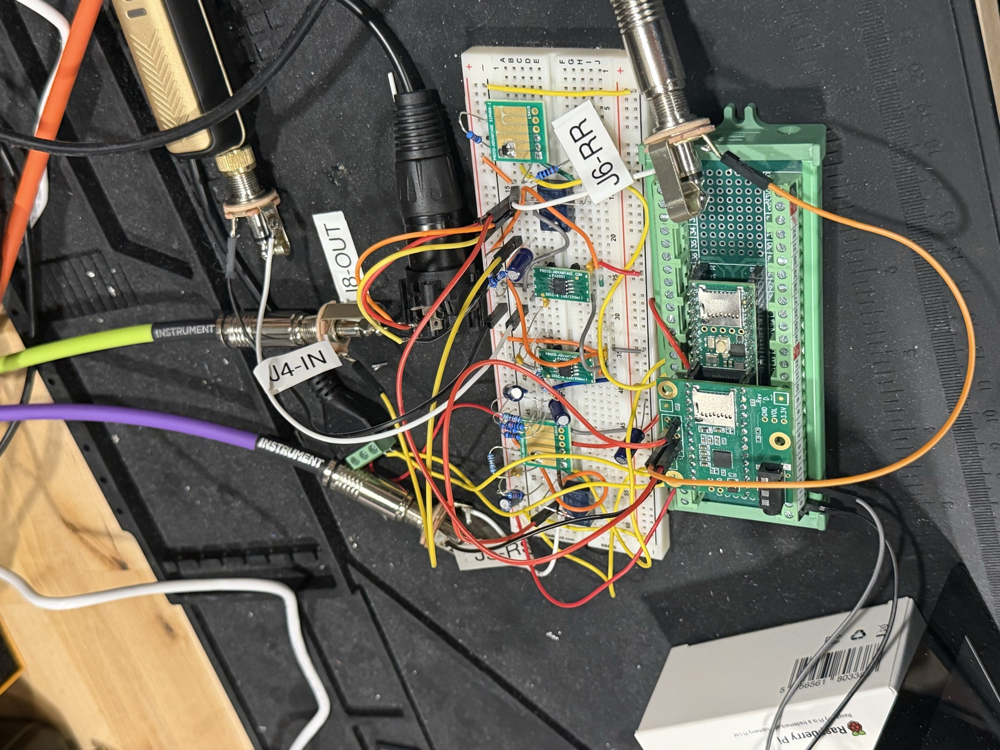
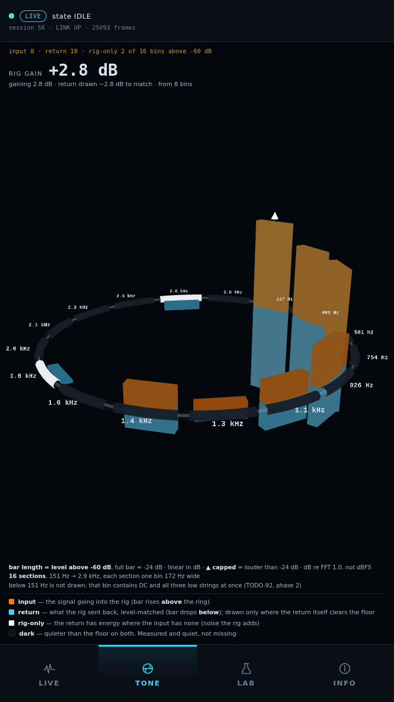
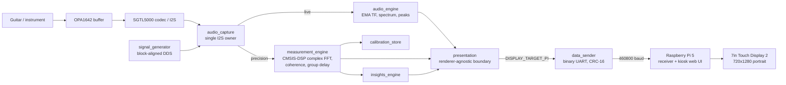
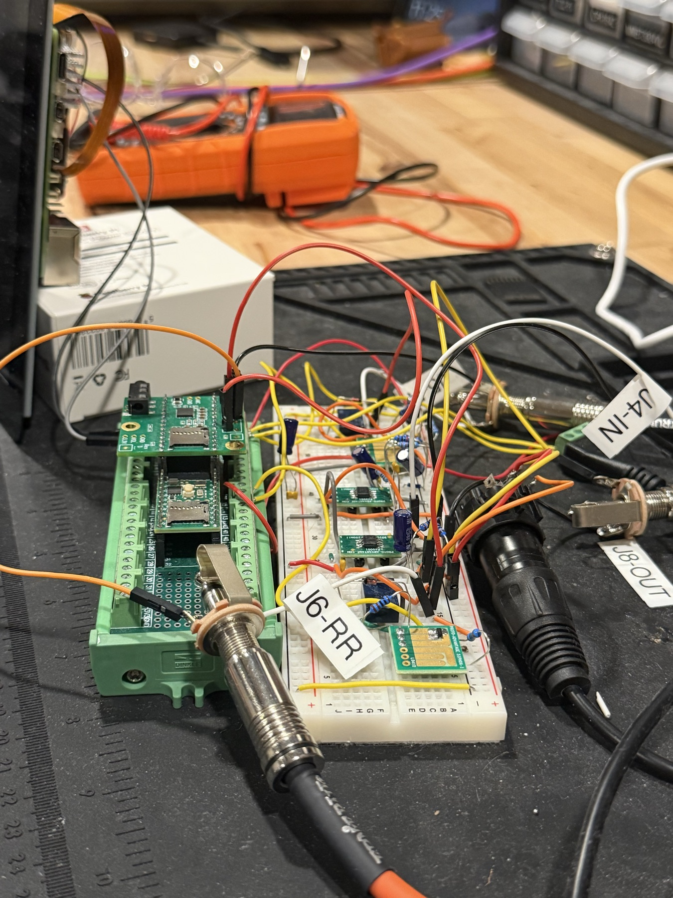

# Guitar Rig Analyzer

A bench instrument that shows what a guitar rig does to the signal going
through it. Plug a guitar or a test signal in, send it through a pedalboard or
amp modeler, bring the output back, and the analyzer compares the two frequency
by frequency on a touchscreen.

A **Teensy 4.1** captures the audio and does all of the measurement math. A
**Raspberry Pi 5** draws the results on a 7" touch display. The rule the whole
design follows: the Teensy decides what is true, and the Pi only displays it.
The Pi never computes a measurement value or decides whether one is valid.



*The assembled analyzer. Teensy 4.1 and Audio Shield on the right, op-amp
buffers and relays on the breadboard, and the labeled jacks: J4 guitar in, J5
rig send, J6 rig return, J8 amp out, plus the XLR return.
[What's in the photo](ai/evidence/2026-10-26-assembled-analyzer.md).*

| Guitar in, rig return out (TONE view) | The first live measurement on the panel |
|---|---|
|  |  |
| A guitar through the rig on 2026-10-18. Input (orange) rises above the ring, the rig's return (blue) hangs below it, level-matched so the shapes can be compared. The rig was adding 2.8 dB. | A 1 kHz tone, read live off the Teensy's serial link. Bins with no measurement are left blank instead of drawn as zero. |

> **About AI use:** I designed the system, bought the parts, built the hardware,
> and took the bench measurements. Claude wrote most of the firmware and the Pi
> software. Every commit carries a `Co-Authored-By: Claude` trailer.
> [docs/ai-assistance.md](docs/ai-assistance.md) explains who did what.

---

## Why I built it

I spent hours changing amps, pedals and settings on my Headrush and could only
ever *hear* the difference. I wanted to *see* it: put a known signal in,
capture what comes back, and show what changed at each frequency.

## What works

- **A real guitar through a real rig (2026-10-18).** A guitar played through
  the Headrush shows up on the panel as two signals, input and return, with the
  rig's gain computed and the return level-matched on top
  ([evidence](ai/evidence/2026-10-18-pi-tone-return-restored.md)). The LAB view
  shows spectral, EQ, dynamics and noise differences while a song plays through
  the rig.
- **The data link.** A full 8,908-byte measurement result crossed the UART and
  passed its CRC check with all four 512-bin arrays intact. Sustained throughput
  was 36,481 B/s with zero CRC failures, and 6.5 MB of real captured bytes
  replay with every byte accounted for.
- **The display.** The Pi boots straight into a four-tab kiosk (LIVE, TONE, LAB,
  INFO) with no keyboard. It runs at 60 fps with touch navigation and recovers
  by itself when the Teensy is power-cycled.
- **Receive-only Pi.** The Pi opens the serial port read-only, and only the
  Teensy→Pi wire is connected, so the display can't send anything back.
- **Relay routing.** Both TQ2-5V relays switch and release, and the XLR return
  path carries signal.
- **Stable analog front end.** After fixing the op-amp bias (see below), input
  droop went from 327 mV to 6 mV, and it moved only 3–4 mV over three days of
  handling and power cycles.

## What isn't proven yet

- **A controlled A/B comparison.** The procedure is written
  ([docs/ab_headrush_procedure.md](docs/ab_headrush_procedure.md)): fixed pink
  noise in, one Headrush setting changed, everything else held. Until a run is
  documented here with its settings and results, the 2026-10-18 demo shows a
  real rig signal on the panel, not a measured difference between two
  settings.
- **Accuracy.** The four known-signal checks (flat loopback, channel swap, known
  gain offset, known RC filter) haven't been passed, and the instrument isn't
  calibrated. The 563 passing tests check software behavior, not measurement
  accuracy. The next planned check is the known RC filter.
- **Timing under load.** The requirement that sending data must never disturb
  audio capture is still open. The first run of the timing test found a bug in
  the *test*: a "44,490 skipped blocks" figure that came from mixing up two
  counters. Capture looked healthy, but a broken test can't pass a requirement
  ([record](ai/evidence/2026-09-29-t1-harness-block-stride-defect.md)).
- **Clipping on TONE.** LAB marks clipped return peaks; TONE doesn't check the
  clip flags yet (TODO-95). The measurement result also has no per-bin clamp
  flag, so a bin sitting on the −24 dB limit looks like a real reading. The UI
  says so on screen.
- **The op-amp bias is a bring-up fix,** not a final design. The replacement is
  scoped in the journal.
- **Not built:** jack-presence detection (the jacks have no switch contact,
  [ADR-003](docs/adr/ADR-003-jack-presence-is-a-ux-feature.md)), the
  `MODE_PRECISION` and `MODE_LF` modes, the log-sweep generator, and Pi→Teensy
  control. A precision measurement is started from the Teensy's USB console.

---

## How it works



All acquisition, DSP, calibration, routing and quality grading happen on the
Teensy. The results leave through one presentation boundary, so the Pi gets
finished verdicts and only formats, plots and animates them.

The split exists for a reason I learned the hard way. With the display driven
by the Teensy itself, a missing screen once stretched the audio block period
from 46 ms to 2,194 ms and wrecked acquisition. Moving the display to its own
processor makes a display failure harmless. See
[ADR-001](docs/adr/ADR-001-display-architecture.md) and
[ADR-005](docs/adr/ADR-005-pi-rendering-stack-and-presentation-semantics.md).

The measurement uses a 1024-point complex FFT (CMSIS-DSP `arm_cfft_f32`) with
50% overlap, an H1 transfer-function estimator, coherence, and unwrapped group
delay. A state machine runs `IDLE → ARMED → CAPTURE → PROCESSING → RESULT`, and
a new result arrives every 512-sample hop: 46.4 ms predicted, 46.3 ms measured.

## Hardware

| Part | Details |
|---|---|
| MCU | Teensy 4.1 (NXP iMXRT1062, Cortex-M7 @ 600 MHz) |
| Audio | Teensy Audio Shield Rev D (SGTL5000 codec), I²S |
| Analog front end | OPA1642 JFET op-amp, hand-soldered to a SOIC-8 adapter, biased at 0.874 V by a 47 kΩ / 10 kΩ divider |
| Signal routing | 2× Panasonic TQ2-5V relays, MMBT3904 drivers, 1N4148 flyback diodes |
| Connectors | 3× Switchcraft #11 1/4" jacks, 1× Neutrik XLR |
| Display | Raspberry Pi 5, 7" Touch Display 2 (720×1280 portrait), Freenove HAT |
| Storage | microSD on the Teensy: calibration files, JSON/CSV export |
| Link | Teensy `Serial1` → Pi `/dev/ttyAMA0`, 460800 baud, CRC-16/CCITT |

I built it on a breadboard one phase at a time, following a written bring-up
procedure. The as-built netlist and schematics are in
[docs/asbuilt/](docs/asbuilt/); the schematics are generated from the netlist by
[tools/gen_schematic.py](tools/gen_schematic.py).



*The finished build from a low angle. Earlier build photos, like
[Phase 6's relay and flyback diode](ai/evidence/2026-09-16-phase6-flyback-diode-seated.md),
are in [ai/evidence/](ai/evidence/).*

---

## Repository layout

```
firmware/guitar_rig_analyzer/   Teensy 4.1 firmware, ~15,400 lines of C++
  guitar_rig_analyzer.ino       setup(), loop(), serial command shell
  config.h                      pins, rates, feature flags, versions
  audio_capture                 the single owner of the I2S audio graph
  audio_engine                  live transfer function, spectrum, peaks
  measurement_engine            precision FFT measurement state machine
  measurement_core.h            shared result and calibration structs
  signal_generator              sine / white / pink noise
  signal_router                 relay routing
  calibration_store             binary calibration files with CRC-32
  insights_engine               separates measured facts from advice
  export_engine                 JSON / CSV export to SD
  presentation                  the boundary between measurement and display
  data_sender                   binary UART protocol to the Pi
  display_engine                RA8875 panel (old debug display)
  validation                    the four known-signal tests
  timing_probe                  block-timing instrumentation

pi/                             Raspberry Pi 5 software (Python + JS)
  analyzer_link/                wire protocol: CRC, framing, packets, state
  web/                          kiosk server and browser UI (production)
  analyzer_ui/                  older Tkinter UI, kept as a test reference
  tests/                        563 tests, Python standard library only
  tools/                        capture, replay and byte-audit tools

docs/                           architecture decisions, build procedure,
                                as-built schematics, test procedures
ai/                             engineering journal, todo list, evidence
tools/                          schematic generator, corruption analysis
```

## Building and running

**Firmware** (Arduino IDE with Teensyduino, or `arduino-cli`):

```sh
arduino-cli compile --fqbn teensy:avr:teensy41 firmware/guitar_rig_analyzer
```

`DISPLAY_TARGET` in [config.h](firmware/guitar_rig_analyzer/config.h) selects
the display; `DISPLAY_TARGET_PI` is the production setting. The Adafruit RA8875
libraries are only needed for the old debug display. Firmware version 0.6.0,
wire protocol version 2.

**Pi:**

```sh
sh pi/run_web.sh      # kiosk web UI
sh pi/run_tests.sh    # test suite
```

Python 3 standard library only: no pip packages, no network calls.
Deployment to the Pi is in [pi/deploy/README.md](pi/deploy/README.md).

## Testing

`sh pi/run_tests.sh` runs 563 tests, and they pass. Two are worth pointing
out. One parses the real Teensy headers and fails if the Pi's decoder drifts
from the firmware's wire format. Another fails if the browser UI ever touches
the microphone or Web Audio APIs (`getUserMedia`, `AudioContext`), which keeps
the display from measuring anything on its own.

These tests check that the Pi decodes what the firmware says it sends. They
don't check that the measurement is accurate; that is what
[validation.cpp](firmware/guitar_rig_analyzer/validation.cpp) is for, and it
hasn't been passed yet. Real hardware has caught things the tests missed: an
em dash in the firmware's status text was being garbled by an ASCII decoder,
and no synthetic test caught it because the test data used a plain hyphen.

## The engineering record

[ai/journal.md](ai/journal.md) is the dated reasoning trail (newest first),
[ai/todo.md](ai/todo.md) is the open work with a proof criterion for each item,
and [ai/evidence/](ai/evidence/) holds the raw captures, logs, photos and the
exact firmware image that was flashed. [ai/README.md](ai/README.md) explains
how to read them. Good places to start:

1. **The op-amp bias defect** (journal, 2026-09-05). The OPA1642 was biased
   outside its input common-mode range. A resistance check ruled out a short
   before anyone replaced the part, and the part turned out to be fine.
2. **Phase 6 stopped at column 45** (journal, 2026-09-15). The procedure said a
   breadboard column was free, but I remembered putting two resistors there.
   I stopped before wiring it. The next power-up would have driven a 3.3 V
   output pin into the analog reference.
3. **The return-path wiring fault** (journal, 2026-10-18). The instrument showed
   the rig's return was dead. Tracing it with the netlist and a touch test led
   to a bad solder joint on the codec's LINE IN R pad.
4. **The timing test that was wrong**
   ([record](ai/evidence/2026-09-29-t1-harness-block-stride-defect.md)).

Architecture decisions are in [docs/adr/](docs/adr/), and the full build
procedure, including fixes for eleven mistakes found while building, is in
[docs/breadboard_bringup_v3.md](docs/breadboard_bringup_v3.md).

---

**Conley Vidal**
