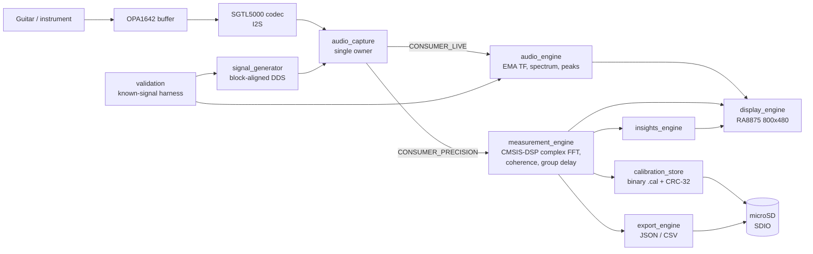

# Guitar Rig Analyzer

Teensy 4.1 firmware that measures what a guitar rig (pedalboard, amp front-end, cable, FX loop) does to a signal — bin-by-bin transfer function, coherence, group delay, and a live spectrum/meter UI on an 800×480 touchscreen.

## Overview

Guitar Rig Analyzer is bench-grade embedded firmware for an instrument-signal measurement instrument. The user routes a signal from the instrument through a **SOURCE_NODE** measurement point, through the rig under test, back through a **RETURN_NODE** measurement point, and the firmware computes the per-bin transfer function `H(f) = RETURN / SOURCE` together with coherence γ², group delay, peak levels, and clipping flags. Results render live on an RA8875 800×480 IPS panel and can be exported to SD as JSON fingerprints or CSV baselines.

The firmware is structured around **logical signal nodes** (SOURCE_NODE, RETURN_NODE) rather than physical channels, so the same code will move from the current bench harness (stereo I2S into a Teensy Audio Shield) onto the final hardware (relay-/mux-routed mono inputs) without changes above the audio_capture layer.

This is a working in-tree firmware project — not a library and not packaged for distribution. There is no installer, no CI, no release artefact. You build it with the Arduino IDE (or `arduino-cli`) targeting Teensy 4.1 and flash directly.

Current version (from [config.h](config.h#L49)): **0.5.0**.

## Key features

Concrete capabilities present in the source today:

- **Live spectrum + transfer function display.** Source/return spectra and EMA-smoothed `tf_db[]` curve, 10.8 fps target on RA8875 (see [audio_engine.cpp](audio_engine.cpp), [display_engine.cpp](display_engine.cpp)).
- **Precision measurement state machine** (`IDLE → ARMED → CAPTURE → PROCESSING → RESULT → IDLE`, with sticky `ABORTED`) that performs complex-FFT accumulation, H1 estimator, cross-spectrum, coherence γ², and atan2-unwrapped group delay via CMSIS-DSP `arm_cfft_f32()` ([measurement_engine.cpp](measurement_engine.cpp), [measurement_core.h](measurement_core.h)).
- **Calibration store** with binary `.cal` files protected by CRC-32 (IEEE 802.3, `0xEDB88320`), enum range validation, ASCII-sanitised description field, and atomic save (backup → write → verify CRC by readback → restore on failure) ([calibration_store.cpp](calibration_store.cpp)).
- **Block-aligned stimulus generator** (sine, white noise, pink noise — log sweep stubbed) with explicit start-block synchronisation and missed-start detection ([signal_generator.cpp](signal_generator.cpp)).
- **Insights engine** that separates **MEASUREMENT** facts (what was observed) from **ADVISORY** inferences (what it likely means), with a quality gate and five detectors (e.g. polarity inversion) ([insights_engine.cpp](insights_engine.cpp)).
- **Known-signal validation harness** with four test modes (flat loopback, channel-swap symmetry, known gain offset, known RC filter) plus a preflight level check ([validation.cpp](validation.cpp)).
- **JSON fingerprint and CSV baseline export** to SD with RFC 8259-compliant string escapes, filename safety validation (`/`, `\`, `..`, control bytes rejected), and partial-file cleanup on write failure ([export_engine.cpp](export_engine.cpp)).
- **Single-owner audio capture** (`audio_capture`) with a dual-consumer model — live display consumes one slot, precision measurement consumes another — and a `ROUTE_CHANGED` event that propagates from `audioEngine_setRoute()` through `audioCap_notifyRouteChanged()` to cancel any in-flight precision capture ([audio_capture.cpp](audio_capture.cpp)).
- **Serial command shell** (single-key commands over USB Serial: `v 1 2 3 4 r m i x s b c`) for bench operation ([guitar_rig_analyzer.ino:280-417](guitar_rig_analyzer.ino#L280-L417)).

Items mentioned in source comments as **not yet implemented**:

- `signal_router` module (relay/mux hardware routing) — referenced for v0.3 milestone.
- `MODE_PRECISION` and `MODE_LF` measurement modes — `measurementEngine_arm()` rejects them today; all factories use `MODE_LIVE` ([measurement_engine.h:14-18](measurement_engine.h#L14-L18)).
- Internal log sweep generator — `signal_generator.cpp` emits a loud warning for `INTERNAL_LOG_SWEEP` and falls back.
- Touch UI on RA8875 — pin is wired (`RA8875_INT_PIN = 9`) but the touch handler is not present.

## Architecture

Single-threaded super-loop running on the Teensy 4.1's ARM Cortex-M7 at 600 MHz. The Teensy Audio Library DMAs I²S samples into an `AudioRecordQueue` owned by `audio_capture`; the codec, capture queue, peak/FFT objects, and routing mixers all live in that module. Two consumers read from it: `audio_engine` (live display) and `measurement_engine` (precision capture). The only module that owns its own Audio Library objects upstream is `signal_generator`, which produces the stimulus and patches into `s_mixer_ret` slot 2 by contract.



Key invariants enforced by the code:

- **`audio_capture`** owns the entire SINK chain: SGTL5000 codec, `AudioInputI2S`, the two routing `AudioMixer4`s, `AudioAnalyzeFFT1024`/`AudioAnalyzePeak`, `AudioRecordQueue`, `AudioOutputI2S`, and `AudioControlSGTL5000`. No other module touches the input/codec/peak/FFT objects directly. `signal_generator` is the one acknowledged exception — it owns the SOURCE chain (`AudioSynthWaveformSine`, `AudioSynthNoiseWhite`, its own `AudioMixer4`) and feeds into `s_mixer_ret` slot 2 by contract; `audioCap_notifyRouteChanged()` is aware of that slot and restores its gain after every route change ([audio_engine.h:9-23](audio_engine.h#L9-L23), [signal_generator.cpp:83-99](signal_generator.cpp#L83-L99)).
- Logical nodes (`SOURCE_NODE`, `RETURN_NODE`) are the abstraction every module above `audio_capture` uses; physical I²S channel numbers live inside `SignalRoute` and stay internal.
- State transitions in `measurement_engine` happen only inside `measurement_engine`. External callers can only `arm()`, `cancel()`, and `acknowledgeAbort()` ([measurement_engine.h:68-72](measurement_engine.h#L68-L72)).
- A latched `ABORTED` state is **sticky** — the user must explicitly acknowledge with `x` before the live view resumes — so the abort reason stays visible.

## Tech stack

| Layer | Choice |
|------|--------|
| MCU | Teensy 4.1 (NXP iMXRT1062, Cortex-M7 @ 600 MHz, 1 MB DTCM + 1 MB OCRAM) |
| Toolchain | Arduino IDE + Teensyduino (or `arduino-cli` with `teensy:avr:teensy41`) |
| Audio | Teensy Audio Library (bundled with Teensyduino) — I²S to SGTL5000 |
| DSP | CMSIS-DSP `arm_cfft_f32` for complex FFT in precision path |
| Display | Adafruit RA8875 (SPI) |
| Storage | microSD via Teensy 4.1 on-board SDIO (binary `.cal` + JSON/CSV exports) |
| Language | C++ (Arduino dialect, single `.ino` translation unit + headers/`.cpp` files) |

Pinned library versions (from [guitar_rig_analyzer.ino:12-14](guitar_rig_analyzer.ino#L12-L14)):

- Adafruit RA8875 ≥ v1.4.x
- Adafruit BusIO (auto-installed alongside RA8875)
- Teensy Audio Library (bundled with Teensyduino — no separate install)

## Repository structure

```
.
├── guitar_rig_analyzer.ino       Arduino entry point — setup(), loop(), Serial command shell
├── config.h                      All pin assignments, FFT/display constants, FIRMWARE_VERSION
├── audio_capture.{h,cpp}         Single I2S owner, dual-consumer model, ROUTE_CHANGED events
├── audio_engine.{h,cpp}          Live display consumer: EMA TF, spectrum, peak metering
├── measurement_engine.{h,cpp}    Precision state machine + complex FFT + calibration apply
├── measurement_core.h            Shared structs (MeasurementResult, CalibrationBuffer, etc.)
├── signal_generator.{h,cpp}      Block-aligned DDS (sine / noise — sweep stubbed)
├── calibration_store.{h,cpp}     Binary .cal load/save/validate with CRC-32 + atomic write
├── export_engine.{h,cpp}         JSON fingerprint + CSV baseline export to SD
├── insights_engine.{h,cpp}       MEASUREMENT vs ADVISORY interpretation layer
├── display_engine.{h,cpp}        RA8875 live + result + insight panel rendering
├── validation.{h,cpp}            Four-test known-signal validation harness
├── audit/
│   └── Remediation_Report_2026-05-15.md   v0.5.0 fixes + appendix folding in the 2026-03 review
├── development/                            Pre-integration firmware staging (signal_router,
│                                           data_sender, audiocap_injection_api) — see its README
├── visualizations/                         RA8875 display design spec + React mockups
│                                           (panel concepts plus an unrelated 3D music-viz prototype)
├── mock-test/                              Host-side dependency-free regression checks
├── .github/
│   ├── copilot-instructions.md            Always-on AI assistant context for this repo
│   └── prompts/                           Reusable slash-command prompts (`/review-firmware`, etc.)
├── docs/
│   └── ai/                                Human-facing onboarding for the AI-assist assets
├── .claude/                               Claude Code per-developer settings (gitignored body)
├── CLAUDE.md                              One-line pointer to .github/copilot-instructions.md
└── .gitignore                    Excludes build/, *.elf/*.hex/*.bin/*.eep/*.lst/*.map
```

> **Build inputs are direct children of the repo root only** (`*.ino`, `*.cpp`, `*.h` at this level). Everything in a subdirectory — `development/`, `visualizations/`, `mock-test/`, `audit/`, `.github/`, `docs/`, `.claude/` — is **not** compiled into the firmware. Do **not** `cp -r * <sketch>/` when copying into a temp sketch folder; copy the root files explicitly. See the "Running locally" section below for the correct flow.

> AI assistants (Claude Code, GitHub Copilot, Codex, etc.) are first-class citizens in this repo. Their customization assets (always-on context, slash-command prompts, per-folder docs) live under [`.github/`](./.github/) and [`docs/ai/`](./docs/ai/). New here? Start at [docs/ai/README.md](./docs/ai/README.md).

## Prerequisites

- **Teensy 4.1** board.
- **Teensy Audio Shield (Rev D)** with SGTL5000 codec.
- **Adafruit RA8875 driver board + 800×480 5" IPS panel** on SPI.
- **OPA1642 analogue buffer** between the instrument and the codec line input.
- **microSD card** in the Teensy 4.1's SDIO slot.
- **Arduino IDE 2.x** with **Teensyduino** installed, or **`arduino-cli`** with the Teensy core.
- USB cable to the Teensy.
- Optional but recommended for validation: a Y-split TS loopback cable and a resistive pad / RC filter known reference (see `validation_runAll()` test list).

## Setup

```bash
git clone <this-repo> "Guitar Rig"
cd "Guitar Rig"
# Install Adafruit RA8875 (and BusIO) via Arduino Library Manager,
# or with arduino-cli:
arduino-cli lib install "Adafruit RA8875"
```

There are no package manifests, no `.env` files, no toolchain pinning beyond the Arduino board package. Reproducibility relies on the Teensyduino version installed locally.

## Configuration

All compile-time configuration lives in [config.h](config.h). There is no runtime environment variable surface. The most commonly-touched constants:

| Constant | Default | Purpose |
|---|---|---|
| `FIRMWARE_VERSION` | `"0.5.0"` | Stamped into measurement results and Serial banner. |
| `RA8875_CS_PIN` / `_INT_PIN` / `_RESET_PIN` | 10 / 9 / 8 | RA8875 SPI control pins. |
| `SGTL5000_LINE_IN_LEVEL` | `5` (0–15) | Analogue PGA gain. **Calibration placeholder — recalibrate per build.** |
| `SGTL5000_HEADPHONE_VOL` | `0.5f` | Headphone monitor volume, 0.0–1.0. |
| `SOURCE_NODE_PHYSICAL_CH` | `0` | I²S channel currently carrying SOURCE_NODE (bench harness binding). |
| `RETURN_NODE_PHYSICAL_CH` | `1` | I²S channel currently carrying RETURN_NODE. |
| `FFT_SIZE` / `SAMPLE_RATE` | `1024` / `44100` | Fixed by `AudioAnalyzeFFT1024`; do not change without library work. |
| `FFT_AVERAGE_COUNT` | `4` | Raw frames per averaged output block (~93 ms). |
| `TF_SMOOTHING_ALPHA` | `0.15f` | EMA weighting for live TF — smaller = smoother/laggier. |
| `TF_SOURCE_GATE` | `0.001f` | Linear FFT magnitude below which a bin is treated as unenergised. |
| `TF_CONFIDENCE_THRESHOLD` | `0.10f` | Minimum in-band bin fraction before "LOW SIGNAL" warns. |
| `CLIP_THRESHOLD_DBFS` | `-0.5f` | Level at/above which a clip flag latches. |
| `SD_LOG_PREFIX` | `"rig_log_"` | Prefix used by SD log filenames. |
| `CAL_FILE_DEFAULT` | `"rig_cal.cal"` | Default calibration file at SD root. |
| `EXPORT_DIR_DEFAULT` | `"exports"` | SD subdirectory for JSON/CSV exports. |

The header has an **EDITING GUIDE** block at the top explaining tuning direction for each commonly-edited constant — read it before changing anything in there.

## Running locally (i.e. on the Teensy)

**Arduino IDE settings** (from [guitar_rig_analyzer.ino:17](guitar_rig_analyzer.ino#L17)):

- Board: **Teensy 4.1**
- Optimize: **Fastest**
- CPU Speed: **600 MHz**
- USB Type: **Serial**

Compile and flash with the IDE's upload button, or via `arduino-cli`.

> **`arduino-cli` folder/sketch-name caveat.** Arduino's CLI expects the sketch directory and the entry `.ino` to share a name. This repo's folder is `Guitar Rig` and the entry point is [guitar_rig_analyzer.ino](guitar_rig_analyzer.ino), so `arduino-cli compile … .` fails with `main file missing from sketch: …/Guitar Rig.ino`. Use the temporary sketch folder workflow below until the repo is renamed:

```bash
mkdir -p /tmp/grig_compile/GuitarRigCompile
cp guitar_rig_analyzer.ino /tmp/grig_compile/GuitarRigCompile/GuitarRigCompile.ino
cp *.cpp *.h /tmp/grig_compile/GuitarRigCompile/
arduino-cli compile --fqbn teensy:avr:teensy41 /tmp/grig_compile/GuitarRigCompile
arduino-cli upload  --fqbn teensy:avr:teensy41 /tmp/grig_compile/GuitarRigCompile
```

Do **not** `cp -r *` — that would pull every subdirectory (`development/`, `visualizations/`, `audit/`, `mock-test/`, `.github/`, `docs/`) into the sketch folder. `development/` in particular contains C++ source for the *next* milestone (`signal_router`, `data_sender`) that is intentionally not yet wired in — silently including it would either break the build or worse, change behavior. Copy `.ino`, `.cpp`, `.h` from the root explicitly. The Arduino IDE handles this transparently and does not need the workaround.

Then open a serial monitor at 115200 baud. On boot the firmware prints `[Main] Guitar Rig Analyzer v0.5.0 ...`, initialises capture/codec/display, and enters the live view.

### Serial commands

Single-key commands do not require a newline; numeric follow-up prompts do ([guitar_rig_analyzer.ino:280-417](guitar_rig_analyzer.ino#L280-L417)):

| Key | Action |
|---|---|
| `v` / `V` | Run full validation suite (`validation_runAll()`). |
| `1` | Test 1 — flat loopback (Y-split). |
| `2` | Test 2 — channel-swap symmetry. |
| `3` | Test 3 — known gain offset (prompts for expected dB). |
| `4` | Test 4 — known RC filter (prompts for corner Hz). |
| `r` / `R` | Reset EMA smoothing + accumulators. |
| `m` / `M` | Arm a rig-analysis precision measurement (32 averages, requires external stimulus). |
| `i` / `I` | Print current insights to Serial. |
| `x` / `X` | Cancel measurement / acknowledge sticky abort / return from result view. |
| `s` / `S` | Save current `MeasurementResult` as JSON fingerprint to SD. |
| `b` / `B` | Save current result as baseline TF CSV. |
| `c` / `C` | Save current result as system calibration (`rig_cal.cal`). |

`c` and `s` only work when measurement state is `RESULT`; the firmware prints a guarded "ignored: need a RESULT state measurement first" message otherwise.

## Testing

There is no host-side test framework. Verification is done **on hardware** via the validation harness in [validation.cpp](validation.cpp):

1. **Test 1 — Flat loopback.** Connect a Y-split TS loopback so SOURCE_NODE feeds back into RETURN_NODE. Expect `tf_db[]` flat within tolerance over 200 Hz – 10 kHz.
2. **Test 2 — Channel-swap symmetry.** Same physical setup; firmware swaps the channel binding via `audioEngine_setRoute()` and re-measures. Asymmetry indicates a per-channel gain error.
3. **Test 3 — Known gain offset.** Insert a resistive pad of known attenuation in the RETURN_NODE path; firmware compares measured offset against the user-supplied expected value.
4. **Test 4 — Known RC filter.** Insert an RC low-pass of known corner frequency; firmware checks slope and `tf_at_2fc`.

Each test runs a preflight level check first (target peak in `[TARGET_LEVEL_DBFS_MIN, TARGET_LEVEL_DBFS_MAX]`) and aborts the suite if levels are wrong before any criterion is evaluated.

Tolerances are intentionally conservative on first pass. `printResult()` emits a "consider tightening" advisory when a criterion passes with > 50 % headroom — see CHANGED [audit-9] in [validation.h](validation.h).

## Operational notes

- **Logging surface.** The firmware logs to USB Serial. There is no remote telemetry. Calibration files, JSON fingerprints, and CSV exports are written to the microSD card.
- **Sticky abort.** A measurement that aborts (route changed mid-capture, hard parameter mismatch on stored calibration, etc.) latches in the `ABORTED` state until `x` is pressed. This is deliberate — see [measurement_engine.h:55-66](measurement_engine.h#L55-L66).
- **Headphone passthrough** (SOURCE → left, RETURN → right) is a **temporary** bench convenience for ear-checking the signal path. It will be replaced by a user-selectable monitor source when `signal_router` and the touch UI land.
- **FFT block timing.** Averaged output block ≈ 92.9 ms (4 × 1024 / 44100); target display rate ≈ 10.8 fps. If the display stalls audio, raise `DISPLAY_UPDATE_EVERY_N_FRAMES` to 2.

## Security / trust boundaries

This is a bench instrument with no network surface. The only externally-controlled inputs are:

- **microSD card contents** — `.cal` files are validated for safe root-level filenames, CRC-32, enum range (mode/sample rate/window/etc.), finite calibration floats, and ASCII-printable description before being committed to RAM ([calibration_store.cpp](calibration_store.cpp)). Stage-to-temp + commit-on-success means a truncated or corrupted file cannot overwrite a known-good in-RAM calibration.
- **USB Serial** — single-key commands, plus two numeric bench prompts parsed through fixed-size buffers while the audio queues continue to drain. No authentication; the device is assumed physically controlled.
- **Filename inputs to export** — validated via an internal `isSafeFilename()` check that rejects `/`, `\`, any `..` sequence, control bytes, and high-bit bytes ([export_engine.cpp](export_engine.cpp)).

There is no secret material in this codebase. There is **no LICENSE file** committed (see Red flags below).

## Troubleshooting

- **"LOW SIGNAL" persistent on the TF display.** Source bins are below `TF_SOURCE_GATE` (linear 0.001 ≈ −60 dBFS). Increase `SGTL5000_LINE_IN_LEVEL` until peaks sit in −12 to −6 dBFS.
- **Validation Test 1 fails on confidence.** Was unreachable in earlier versions because confidence divided by all 512 FFT bins; v0.5.0 reports confidence over the 200 Hz – 10 kHz analysis band only. If still failing, check loopback cable continuity and source level.
- **Calibration save reports "Cal save FAILED — check SD".** SD not inserted, full, write-protected, or the readback CRC verification failed. The on-disk file is removed on failure; the in-RAM calibration is restored from the pre-save backup.
- **Measurement self-aborts with `ROUTE_CHANGED`.** A `SignalRoute` change was issued mid-capture (e.g. swapping channels for calibration). This is by design — the accumulator cannot be trusted across a channel-binding change.
- **Form-feed (`^L`) characters appearing in files.** Strip with `tr -d '\014' < file > file.new`; they have caused tool issues in past edit sessions.

## Recent work

See [audit/Remediation_Report_2026-05-15.md](audit/Remediation_Report_2026-05-15.md) for the v0.5.0 remediation pass: 13 critical compile-blocking truncations fixed, NaN-poisoning chains blocked in the EMA path, atomic calibration save implemented, validation harness made deterministic, JSON escapes brought to RFC 8259.

## License

> _TBD: no `LICENSE` file is present at the repo root._ The intended license is not declared anywhere in the source. The maintainer should add one explicitly before sharing this code outside the bench.

## Maintainers

> _TBD: no `CODEOWNERS` file, no package author metadata, and the project is not on a hosted git server with a clear owner. The only authoring evidence is the single recent commit (`0e9fd4b Initial import: Guitar Rig Analyzer v0.5.0`)._
