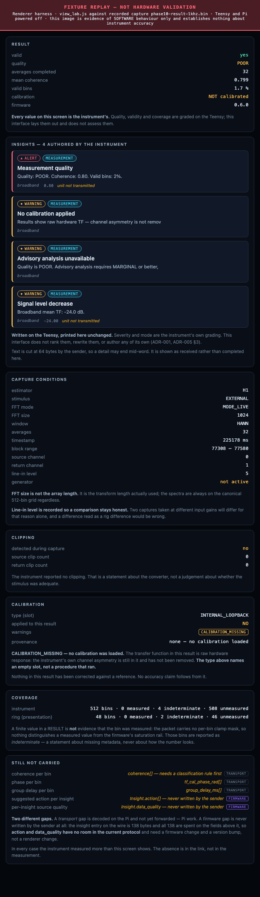

# LAB renderer — four Teensy-authored insights on screen

**2026-10-13 · macOS · `FIXTURE REPLAY — NOT HARDWARE VALIDATION`**

## 🛑 What this is not

**This establishes nothing about instrument accuracy.** It is a headless
Chromium render of `view_lab.js` against bytes recorded on **2026-09-27**. The
Teensy and the Pi were **powered off and physically inaccessible** for the whole
of this work. No measurement was taken, no calibration exists, and the capture
being displayed is itself graded `POOR` by the instrument that produced it.

It is evidence of **software behaviour**: that the renderer places
firmware-authored fields on screen without altering them. Nothing more.

Per `docs/ui/README.md` §5, a fixture replay in `ai/evidence/` is acceptable
**only while labelled as one** — hence the banner burned into the image and this
file beside it.

## What it shows

| | |
|---|---|
| Source | `ai/evidence/phase10-result-1khz.bin` |
| Served by | `python3 -m web.server --fixture … --port 8801` |
| Rendered by | `pi/web/static/view_lab.js` at `c770053`+1 |
| Harness | a temporary page importing the real module; **deleted after capture**, never committed |

Four insights, authored on the Teensy and printed verbatim:

1. `ALERT` / `MEASUREMENT` — **Measurement quality** — "Quality: POOR. Coherence: 0.80. Valid bins: 2%."
2. `WARNING` / `MEASUREMENT` — **No calibration applied**
3. `WARNING` / `MEASUREMENT` — **Advisory analysis unavailable**
4. `WARNING` / `MEASUREMENT` — **Signal level decrease** — "Broadband mean TF: -24.0 dB."

All four are `MEASUREMENT` mode. **The instrument authored no `ADVISORY` at all**,
and insight 3 says why: advisory analysis requires MARGINAL quality or better and
this result is POOR. The advisory styling in the renderer is therefore **unproven
against real bytes** — no recorded capture exercises it.

## Three things to read carefully

**Insight 2's detail ends "is not remov".** That is the sender truncating at 64
bytes, not a rendering fault. The firmware struct allows 128. It is shown as
received rather than completed, because completing it here would make the
renderer a co-author.

**`0.80` beside insight 1 carries no unit, deliberately.** The struct field is
`magnitude_db`, but `insights_engine.cpp:170` passes `mean_coherence` — a
dimensionless ratio — into that slot. The unit is a function of which insight
produced the value and is not on the wire.

**`CALIBRATION_MISSING` with type `INTERNAL_LOOPBACK`.** The type names an empty
*slot*. No calibration ran. The card says so in words so the type cannot be
misread as a procedure that happened.

## Still not on this screen

`coherence[]`, `tf_cal_phase_rad[]` and `group_delay_ms[]` are decoded on the Pi
and not yet forwarded — Step C/D, deferred. `Insight.action[]` and
`Insight.data_quality` are a **firmware** gap: `data_sender.cpp` never writes
them and the 138-byte wire entry is fully spent, so they need a protocol version
bump rather than renderer work.
