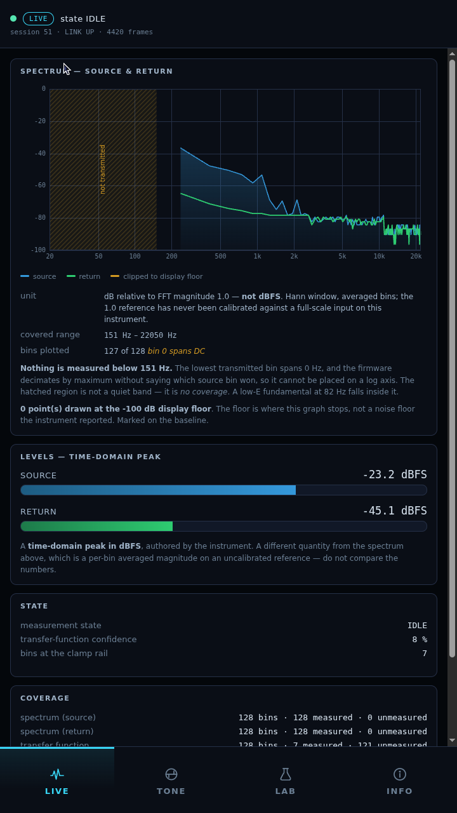

# The Pi boots into the web kiosk — ADR-005 §2.1, verified by a controlled reboot

**2026-10-15, 21:01 PDT.** The last of ADR-005 §2's four conditions, and the one
that makes the web client the **production default**.

**No firmware change, no protocol change, no wiring change, no measurement
initiated.** One configuration file changed and one new script was added. The
Teensy was not touched; the Pi's own checkout was not touched.

---

## The change, in full

| | |
|---|---|
| `~/.config/labwc/autostart` | one active line, `b40fbc70…` → `e9f90ba9…` |
| From | `/home/conley/guitar_rig_analyzer/pi/run_ui.sh --serial /dev/ttyAMA0 &` |
| To | `/home/conley/gra-ui/pi/run_kiosk_boot.sh &` |
| New file | `pi/run_kiosk_boot.sh`, `faf87fe7…` — boot supervisor |
| New deployment | `~/gra-ui/`, byte-identical to this repository's `pi/` tree |
| `/etc/xdg/labwc/autostart` | **unchanged**, `3a53212a…` |

`pi/deploy/` in this repository now holds verbatim copies of the installed
autostart, the Tk original and the rollback script. **They are copies, not the
live configuration** — see [`../../pi/deploy/README.md`](../../pi/deploy/README.md).

## Reboot result

| | Before | After |
|---|---|---|
| `boot_id` | `d5e0df9b-19cd-4065-aeb5-17683a9bf19d` | **`1979fd90-b75d-4d44-8a76-b18db9335eab`** |
| `btime` | `1792120422` | **`1792123278`** |

A genuinely fresh boot, not a re-login.

### Timeline, from `btime` and `/proc/<pid>/stat` start times

```
21:01:18  +0 s   kernel boot
21:01:28  +10 s  supervisor 1504 starts; compositor socket found after 0 ms
21:01:28  +10 s  run_web.sh 1571; transport 1576 up, port open after 200 ms
21:01:29  +11 s  chromium 1787 exec
```

Attempt **1 of 3** succeeded. No retry, no fallback.

### Acceptance

| # | Criterion | Result |
|---|---|---|
| 1 | Web UI appears automatically | ✅ LIVE view on the panel, no intervention |
| 2 | Tk UI does **not** start | ✅ zero `analyzer_ui` processes |
| 3 | Real Teensy telemetry | ✅ session **51**, `LINK UP`, 4420 frames, SOURCE −23.2 dBFS |
| 4 | Exactly one UART holder | ✅ **1** fd, pid 1576 `web.server` |
| 5 | No duplicate Chromium or transport | ✅ 1 supervisor → 1 launcher → 1 transport + 1 kiosk browser |
| 6 | No decode errors / stale link | ✅ `decode_errors 0`, `stale false` |
| 7 | No thermal throttling | ✅ 46.1 °C, `throttled=0x0` |
| 8 | Autostart integrity | ✅ user `e9f90ba9…`, system `3a53212a…` unchanged |



`grim` off the live compositor at 720×1280, SHA-256
`820f428dd27e8785d0c804cf969fccb6f3ef4327acdb78034690f11d95c8993f`. The LIVE
spectrum is drawn from real bins — SOURCE is energised, confidence 8 %, 7 bins
at the clamp rail.

**Session 51** is the check that the Pi reboot did not disturb the instrument:
a Pi reboot does not power-cycle the Teensy, so the counter should not move, and
it did not.

## 🛑 What this does NOT establish

**First-paint time was not measured.** The numbers above are process *exec*
times from `/proc`. Nothing instrumented the moment the first pixel appeared, so
**"boot to usable UI" is not a figure this record can supply** — only
"boot + 11 s to Chromium exec". Closing that needs the client to report its
first render, which is a code change and was not made.

**Touch has not been verified by the operator on this boot.** Tap-to-switch was
confirmed on 2026-10-13 with the same client code, but nobody has touched the
panel since the migration.

**One boot, not a population.** A single successful cold start. Nothing here
speaks to repeated boots, to a boot with the Teensy absent, or to a slow-session
boot where the 30 s compositor wait would matter — the socket was ready in 0 ms.

**The Tk fallback path has never fired.** It is written and syntax-checked, and
its two guards (disable flag, lock) were exercised, but **no boot has yet failed
three times**, so the fallback itself is untested in anger.

**Nothing about measurement accuracy.** `IDLE`, no capture armed.

## Rollback, exercised rather than asserted

Before the reboot, `restore-tk-startup.sh` was **run for real**: it restored the
Tk file byte-for-byte to `b40fbc70…`, the hash was verified, and the kiosk config
was then re-applied and re-verified. Both directions work.

```sh
ssh conley@guitar-rig-analyzer.local 'sh ~/gra-rollback/restore-tk-startup.sh'
```

The Tk UI, its launcher (`952cd5ed…`) and the Pi's own dirty checkout
(`ce682cd`, 49 entries) are all preserved untouched.

## Rebooting needs a password, and that is recorded as a fact of the system

`sudo` requires a password on this Pi and polkit refuses `systemctl reboot` from
an SSH session: the session is `Remote=yes`, so `allow_active=yes` does not apply
and the action falls through to `auth_admin_keep`. The reboot was performed by
the operator with `ssh -t … 'sudo reboot'` from the Mac. **No Pi keyboard was
needed**, consistent with the standing rule.

## ADR-005 §2 — all four conditions now met

| # | Condition | State |
|---|---|---|
| 1 | Boot directly into Chromium | ✅ **MET — this record** |
| 2 | Connect to `analyzer_link` | ✅ met 2026-10-13 |
| 3 | Render real protocol-v2 frames | ✅ met 2026-10-13 |
| 4 | Survive disconnect and reconnect | ✅ met 2026-10-15 |

**The web client is the production renderer.** The Tk renderer is retained as
the reference/debug renderer, exactly as ADR-005 §2 specifies — not deleted, not
frozen, and still the thing a disagreement is adjudicated against.
