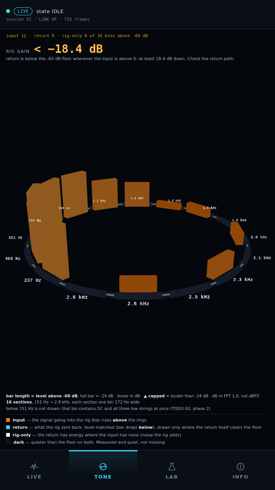

# TONE draws the input over the level-matched return, live on the Pi panel

**2026-10-16, 20:49 PDT.** The redesigned TONE view (`bc3d4b9`, plus the
hold fix `afd1944`) running in the production kiosk against the real UART,
with a Fender Stratocaster strummed about once a second.

**No firmware change, no protocol change, no wiring change, no measurement
initiated.** Pi-side code only: three web files, three static assets and two
test files. The Teensy was not touched.

---

## What is on screen

`2026-10-16-pi-tone-input-over-return.png` (`094d529e…`) is a `grim` capture
of the panel. `…-frame.json` (`35d6a911…`) is the `/api/frame` response taken
in the same instant by a separate request. The screenshot and the JSON are two
polls, not one, so their numbers differ by a frame.

- 16 sections, 151 Hz – 2.9 kHz, one transmitted bin each, labelled in Hz/kHz.
- The input clears the −60 dB floor in 12 of 16 bins; orange bars above the ring.
- **Return: 0 of 16 bins.** The rig-gain readout states a bound, not a value:
  **"< −18.4 dB — return is below the −60 dB floor wherever the input is above
  it. Check the return path."**

## The return path, as observed (NOT diagnosed)

Eight frames at ~0.4 s intervals:

| frame | source peak dBFS | return peak dBFS | gain state | bound dB | input bins on |
|---|---|---|---|---|---|
| 1 | −17.6 | −38.8 | below_floor | −20.69 | 12 |
| 2 | −28.6 | −37.5 | below_floor_held | −22.26 | 2 |
| 3 | −19.4 | −38.2 | below_floor | −19.75 | 10 |
| 4 | −25.8 | −36.9 | below_floor | −17.37 | 5 |
| 5 | −20.1 | −37.6 | below_floor | −23.30 | 8 |
| 6 | −20.6 | −37.3 | below_floor | −19.73 | 7 |
| 7 | −25.7 | −37.4 | below_floor | −12.58 | 6 |
| 8 | −15.1 | −37.2 | below_floor | −25.77 | 9 |

The source peak follows the strums (−15.1 to −28.6). **The return peak does
not** (−36.9 to −38.8), and no displayed return bin reaches −60 dB. An earlier
burst the same evening matched that (source −11.7..−32.6, return
−38.6..−40.5). Whatever the return channel carries, it is not the guitar at a
level the instrument calls energised. **The cause is not established.** This
record does not say whether it is cabling, routing, rig output level or line-in
gain. See TODO-93.

## Deployment

| | |
|---|---|
| Target | `~/gra-ui/` (production, per `labwc-autostart.kiosk`) |
| Pre-check | `~/gra-ui/pi` matched `39a7d55` path-for-path, except the absent `pi/deploy/` and an older `pi/tests/test_web_tone.py` |
| Backup | the 8 replaced files, verbatim: `~/gra-ui-backup-39a7d55/` |
| Copied | the 8 files of `bc3d4b9`, then the 3 of `afd1944`; sha256 checked both sides |
| Tests on the Pi | `python3 -m unittest discover` in `~/gra-ui/pi`: **544 run, OK, 5 skipped** |
| Restart | SIGTERM to the one `run_web.sh` by PID → supervisor logged "ran 19168 s … not restarting", lock released → `run_kiosk_boot.sh` relaunched with the Wayland env; attempt 1 succeeded |
| `boot_id` | `82171efb-c105-45dd-8f80-9d28a1b46b6f` (no reboot) |

🔺 **The first copy left eight AppleDouble `._*` files** (macOS tar metadata).
They broke four tests that read every `*.js` as UTF-8. Those exact eight paths
were removed and the suite re-run clean. The second copy used
`COPYFILE_DISABLE=1 tar --no-xattrs` and produced none.

**Rollback:** copy `~/gra-ui-backup-39a7d55/pi` back over `~/gra-ui/pi`, then
restart the kiosk the same way.

## What this does and does not show

- ✅ The new renderer, payload and gain logic run on the Pi's GPU and Python
  against live protocol-v2 frames, in the production kiosk.
- ✅ Silence lights nothing: bin 0 (DC, −53 dB muted) is off the ring.
- ✅ The below-floor bound is held through the gaps between strums (frame 2).
- ❌ **A level-matched return has NOT been seen on the panel.** The return
  never cleared the floor. The matched-return path, the gain number and the
  white rig-only seat are verified only by tests and by a headless render of a
  synthetic frame. They need an energised return before they count as panel
  evidence.
