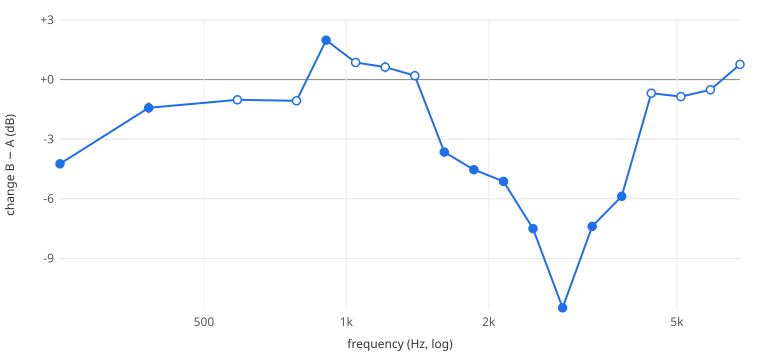

# The Headrush A/B: the instrument detects a real change in a real rig

**2026-10-31.** TODO-91. First controlled measurement in the project that is
about the guitar rig rather than about the analyzer. One Headrush parameter
was switched A → B → A → B under a fixed pink-noise stimulus; the analyzer
reported the same change in both cycles, about 100× larger than the
difference between repeats of the same setting.

## What was compared

| | |
|---|---|
| Rig | Headrush, rig *Slow Dancing In A Burning Room* (holding unsaved edits; never saved, loaded or renamed by the run) |
| The one parameter | `Cab.CabType`: **A = 13 (4x12 Green 20W)**, **B = 0 (1x8 Custom)**. The cab sits after the amp, so the amp sees the same signal in both states |
| Everything else | Budda Comp on (Compression 0.78), Graphic Bass EQ on, Amp *+64 Black Lux Norm* (GainA 0.62), Volume on; reverb, delay, G EQ, both drives off. Full block in `run.json` → `block_before` |
| Stimulus | `pi/tools/pink_noise.py` seed 1, 10 min, −18 dBFS RMS, sha256 `ad5c3632…` (verified on the file played). Phone line out → J4. **Phone volume not recorded**; input peaked −2.2 to −3.1 dBFS, no clipping in any frame |
| Route | TS return, no injection (Teensy diagnostics) |
| Teensy | session **82** in every one of the 1 040 frames; `decode_errors` 0; no stale frame |
| Timing | per state: 30 s dwell after the change, then 50 s LIVE + 15 s with a RESULT armed; 260 frames per state at 4 Hz |

Driven end to end by [`pi/tools/ab_run.py`](../../../pi/tools/ab_run.py)
(Headrush over its own REST API, `m`/`x` over the Teensy USB console, frames
recorded on the Pi by `ab_capture.sh`), then compared by
[`pi/tools/ab_compare.py`](../../../pi/tools/ab_compare.py). `report.md` is
its output verbatim.

## Result

**`ab_compare.py`: CHANGE DETECTED in 10 of 19 bands; largest −11.5 dB at 2 866 Hz, repeat difference there 0.11 dB.**

**🔺 The first report said 11 of 20** (`report-before-dc-fix.md`, kept). Its
extra band, labelled 68 Hz, is fed only by FFT bin 0 (0–151 Hz, `dc: true` in
the frame geometry): not sub-151 Hz data, but DC and three strings in one
bucket (TODO-92). `ab_compare.py` now leaves DC-fed bands out, with a test,
and `report.md` / `delta.svg` were regenerated from the same frames.

| Region | B − A | Both cycles | Repeat |
|---|---|---|---|
| 248 Hz | −4.2 dB | −4.2 / −4.3 | 0.12 |
| 382 Hz | −1.4 dB | −1.3 / −1.5 | 0.28 |
| 906 Hz | **+2.0 dB** | +2.0 / +2.0 | 0.04 |
| 1.6–1.9 kHz | −3.6, −4.5 dB | | ≤ 0.12 |
| 2.1–3.8 kHz | −5.1 to **−11.5 dB** | e.g. −11.5 / −11.4 at 2.9 kHz | ≤ 0.16 |
| 4.4–6.8 kHz | within ±1 dB | | not counted |

A band counts only if it is MEASURED in ≥ 90 % of frames of every state, moves
the same way in both cycles, and moves more than 1 dB **and** more than 3× the
repeat difference (A2 vs A1, B2 vs B1).

## Checks made on the data afterwards

- **The RESULT window did not disturb LIVE.** At 2 866 Hz the mean of the last
  15 s of each state is within 0.4 dB of its first 50 s (A1 −3.14 / −3.00,
  B1 −14.56 / −14.93, A2 −3.09 / −3.13, B2 −14.51 / −14.63); frame-to-frame
  spread ≈ 0.2 dB.
- **Input stability (the in-run TODO-70 check).** The stimulus was never
  touched, yet the input spectrum moved A → B by a median 0.30 dB over 120
  energised bins, largest **+1.38 dB at 2 304 Hz**, which is inside the
  region where the return changed most. That is consistent with a small
  RETURN → SOURCE leak. It bounds the leak's effect on this comparison at
  about 1.4 dB against changes of 5–11.5 dB. **It does not close TODO-70.**

## What this does not show

- **Not a calibrated Headrush or cabinet response.** A differential reading on
  one uncalibrated instrument, minutes apart. dB are instrument readings,
  not volts. It does not close TODO-70, -75 or -78.
- **The RESULTs were all graded POOR**: coherence 0.41 / 0.40 / 0.41
  (A1, B1, A2), 100 % valid bins. B2's RESULT armed and never completed
  (TODO-96). The coherence did not move with the cab. That fits the
  incoherence coming from the compressor and driven amp ahead of it, which
  is an inference and has not been tested.
- **5 bands above 7.8 kHz were CLAMPED** and 21 below 700 Hz have no FFT bin
  at all; the 19 compared are the ones measured in every state, above the DC bin.

## Photos (`photos/`, operator, iPhone 17 Pro Max)

Nine photos of the bench as the run was set up: the panel on LIVE, the
breadboard, the phone playing `pink_noise_ab`. Resized to 1600 px for the
repository; originals on the operator's Desktop as `breadboard1–9.jpeg`.

**🔺 They are from attempt 1's stimulus check, not from the run above.** EXIF
times are 14:47:09–14:49:03 PDT. The panel in every one shows session 82,
**transfer-function confidence 0 %**, and input peaks of −31.7 to −34.5 dBFS:
the noise was reaching the analyzer but too quietly to energise the bins. The
volume went up at ~14:50, and the cab was first switched at 14:51:57, so
every photo shows state A (4x12). The passing run was 15:36–15:44 and has no
photos. Use these as the setup, not as screenshots of the measurement.

## Two failed attempts, kept

| Attempt | What happened | Why it is not used |
|---|---|---|
| 1 (`attempt1-run.log`) | A1, B1 complete; Wi-Fi to the Mac collapsed during A2 (99 of ~320 frames), then a Headrush read timed out and the script died before B2 | Incomplete. Led to recording on the Pi and to retrying Headrush calls |
| 2 (`attempt2-run.log`) | A1 complete; copying it back over the Wi-Fi took 11 min, the stimulus file ended, B1 started in silence; stopped by hand, cab restored | Stimulus not continuous. Led to fetching all states once at the end and to a stimulus check before and after every state |

Their frames are not archived; their logs are.

## Files

| File | sha256 |
|---|---|
| `A1.jsonl.gz` | `45fe4450…` |
| `B1.jsonl.gz` | `1bf1eb99…` |
| `A2.jsonl.gz` | `0c977edc…` |
| `B2.jsonl.gz` | `9e5c1fc6…` |
| `report.md`, `delta.svg` | `2e3bd05a…`, `e08c46f2…` |
| `report-before-dc-fix.md` | `b0545122…` (the run's own output, 11 of 20) |
| `run.json` | `1ec8f992…` (settings, readbacks, RESULT lines) |
| `run.log`, `teensy-console.log` | the run as it happened |

To reproduce the verdict: `gunzip -k *.gz && python3 ../../../pi/tools/ab_compare.py .`
