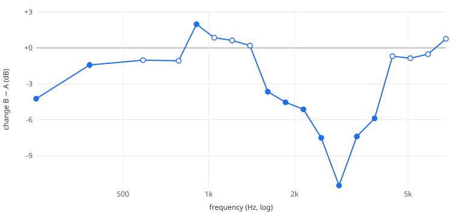

# A/B comparison

**Verdict:** CHANGE DETECTED in 11 of 20 bands; largest -11.5 dB at 2866 Hz, repeat difference there 0.11 dB

## Run

| State | Live frames | Result frames | Peak input dBFS | Peak return dBFS |
|---|---|---|---|---|
| A1 | 260 | 0 | -2.3 | -12.4 |
| B1 | 260 | 0 | -3.1 | -16.3 |
| A2 | 260 | 0 | -2.9 | -12.5 |
| B2 | 260 | 0 | -2.2 | -16.4 |

Teensy session: 82. Checks: all passed.

## Did the input stay the same?

Input spectrum, A vs B, over 120 energised bins: median difference 0.30 dB, largest 1.38 dB. The stimulus was not touched, so any difference here is either noise or return signal leaking into the input (TODO-70). It does not by itself close TODO-70.

## Per band

20 bands measured in all four states. Change = mean(B) − mean(A); repeat = largest A2−A1 or B2−B1 difference. ✔ = counted as a change (same sign both cycles, > 3× repeat and > 1 dB).

| Hz | A dB | B dB | B1−A1 | B2−A2 | Change | Repeat | |
|---|---|---|---|---|---|---|---|
| 68 | -12.2 | -16.7 | -4.6 | -4.5 | -4.5 | 0.04 | ✔ |
| 248 | -9.7 | -13.9 | -4.2 | -4.3 | -4.2 | 0.12 | ✔ |
| 382 | -13.6 | -15.0 | -1.3 | -1.5 | -1.4 | 0.28 | ✔ |
| 588 | -13.6 | -14.6 | -0.9 | -1.2 | -1.0 | 0.17 |  |
| 785 | -11.4 | -12.4 | -1.0 | -1.2 | -1.1 | 0.10 |  |
| 906 | -12.4 | -10.4 | +2.0 | +2.0 | +2.0 | 0.04 | ✔ |
| 1047 | -11.0 | -10.1 | +1.0 | +0.7 | +0.9 | 0.17 |  |
| 1209 | -9.1 | -8.5 | +0.8 | +0.5 | +0.6 | 0.27 |  |
| 1396 | -11.3 | -11.1 | +0.4 | +0.0 | +0.2 | 0.22 |  |
| 1612 | -10.6 | -14.3 | -3.6 | -3.7 | -3.6 | 0.04 | ✔ |
| 1861 | -7.4 | -11.9 | -4.6 | -4.4 | -4.5 | 0.12 | ✔ |
| 2149 | -4.7 | -9.8 | -5.1 | -5.1 | -5.1 | 0.03 | ✔ |
| 2482 | -2.6 | -10.1 | -7.6 | -7.4 | -7.5 | 0.16 | ✔ |
| 2866 | -3.1 | -14.6 | -11.5 | -11.4 | -11.5 | 0.11 | ✔ |
| 3310 | -2.3 | -9.6 | -7.4 | -7.4 | -7.4 | 0.03 | ✔ |
| 3822 | -2.3 | -8.1 | -5.9 | -5.8 | -5.9 | 0.03 | ✔ |
| 4414 | -7.1 | -7.8 | -0.7 | -0.7 | -0.7 | 0.01 |  |
| 5097 | -11.1 | -11.9 | -0.8 | -0.9 | -0.9 | 0.11 |  |
| 5886 | -13.5 | -14.0 | -0.5 | -0.5 | -0.5 | 0.07 |  |
| 6796 | -22.7 | -22.0 | +0.8 | +0.8 | +0.8 | 0.02 |  |

## What this does not show

This is a difference between two settings on one uncalibrated instrument, minutes apart. It is not a calibrated frequency response of the Headrush, and dB values are instrument readings, not volts.
